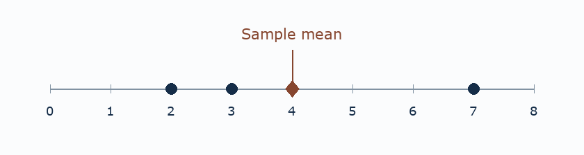

<!-- This elementary authoring example lives outside the site's render list.
Replace every example field and resource for a new note. Copy approved content
only into notes/posts/ and remove draft: true when it is ready for release. -->

::: {#def-sample-mean}
For a real sample $x_1,\ldots,x_n$ with $n\geq1$, define the sample mean by

$$
\bar{x} = \frac{1}{n}\sum_{i=1}^{n} x_i.
$$ {#eq-sample-mean}
:::

::: {#lem-centering}
The centered observations sum to zero.
:::

::: {.proof}
Substituting @eq-sample-mean gives $\sum_i(x_i-\bar{x})=\sum_i x_i-n\bar{x}=0$.
:::

::: {#prp-squares}
For every $a\in\mathbb{R}$,

$$
\sum_{i=1}^{n}(x_i-a)^2 =
\sum_{i=1}^{n}(x_i-\bar{x})^2 + n(\bar{x}-a)^2.
$$ {#eq-centering}
:::

::: {.proof}
Expand the square of $(x_i-\bar{x})+(\bar{x}-a)$ and apply @lem-centering to the cross term.
:::

::: {#thm-least-squares}
The sample mean is the unique minimizer of $a\mapsto\sum_i(x_i-a)^2$.
:::

::: {.proof}
In @eq-centering, the first term is constant in $a$ and the second is nonnegative, with equality exactly when $a=\bar{x}$.
:::

## Numerical illustration

See @tbl-centered and @fig-centered for the sample $(2,3,7)$.

| Observation | Value | Centered value |
|:------------|------:|---------------:|
| 1           | 2     |             -2 |
| 2           | 3     |             -1 |
| 3           | 7     |              3 |

: Values centered at their sample mean. {#tbl-centered}

{#fig-centered fig-alt="A number line shows the observations at 2, 3 and 7 and their mean at 4."}

### MATLAB

```matlab
x = [2, 3, 7];
centered = x - mean(x);
```

### Python

```python
from statistics import mean

x = [2, 3, 7]
centered = [value - mean(x) for value in x]
```

### R

```r
x <- c(2, 3, 7)
centered <- x - mean(x)
```

[Download the demonstration data (CSV)](note-example-data.csv){download=""}

Quarto supports references to equations, numbered statements, tables and figures [@quarto-crossrefs].

## References

::: {#refs}
:::
